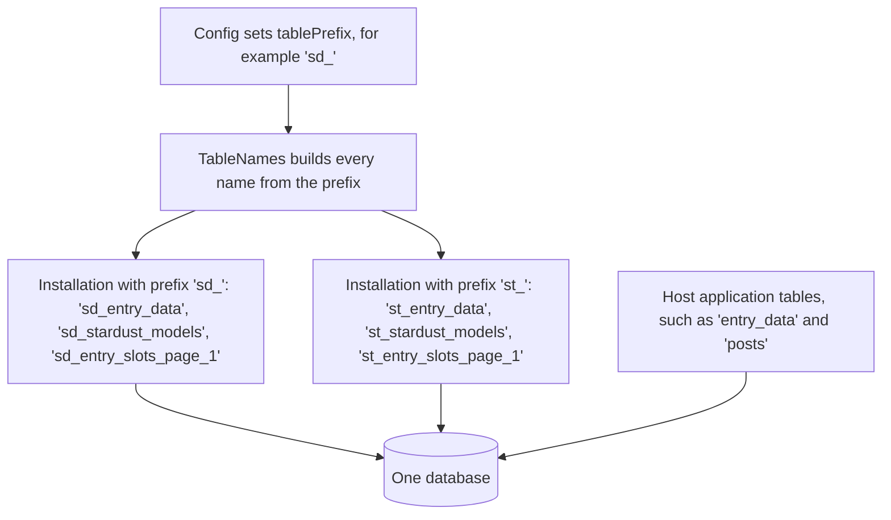
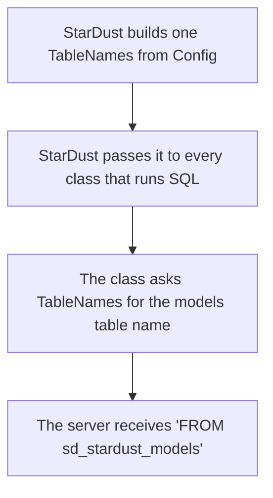

# 0059 - Table Names Take an Optional Installation Prefix

**Status:** Proposed
**Created:** 2026-11-14

## Overview

An *installation* is one set of StarDust tables in a database, together with the daemons that serve it. A *prefix* is text placed in front of every table name, so `entry_data` becomes `sd_entry_data`. In everyday terms, two families sharing one fridge write a name on every container, and each family finds its own. The *bare name* is the name without a prefix, which every installation uses today. A *page table* is one of the `entry_slots_page_N` tables that the Watcher creates when indexed capacity runs low, and *bootstrap* is the command that creates the other tables.

Accepting this ADR means accepting that

- every table and named constraint carries the prefix, including `entry_data` and `backfill_checkpoints` (Decision 1)
- one class builds every name, and a test fails when SQL names a table directly (Decision 2)
- a prefix is 1 to 16 lowercase characters (Decision 3)
- lock names and daemon files also depend on the prefix, so two installations in one database never wait on each other (Decisions 4 and 5)
- the prefix is chosen before the first bootstrap, and nothing moves an existing installation to a prefix (Decision 7)

## Context

Every table the engine creates has a fixed name. `entry_data` and `backfill_checkpoints` are bare, the registry tables begin with `stardust_`, and the page tables are `entry_slots_page_N`. ADR [`0053`](0053-advisory-lock-names-are-qualified-per-installation.md) records the consequence in passing ("StarDust has no table-name prefix") and derives from it the rule that one database holds at most one installation.

That rule conflicts with the hosts ADR [`0048`](0048-bounded-combined-tick-for-cron-driven-hosting.md) made a supported target. A shared hosting account usually provides one database, and that database already holds another application's tables.

### What fails today

| When | Then |
| :-- | :-- |
| A host application owns a table named `entry_data` or `backfill_checkpoints` | Bootstrap runs `CREATE TABLE IF NOT EXISTS`, which skips an existing table whatever its shape. StarDust adopts the host's table, and bootstrap then runs `ALTER TABLE backfill_checkpoints` on it to add columns. |
| The Watcher creates a page table whose name is already taken | The same adoption happens, later. |
| A staging copy is wanted beside production | A second database is needed, and the account has one. |

WordPress solves the same problem with a configurable prefix for `wp_posts`. The engine can offer one once every name has a single definition. A page table name is already built in one place, `PageProvisioner::provision()`, and every later reader takes it from `stardust_pages.table_name`. The other names are literals in SQL strings, about 250 occurrences in roughly 70 files under `src/`, of which about 60 are bootstrap DDL and its `information_schema` probes.

### Which names are scoped to the whole database

A second table was created in one database with a constraint or index named like the first table's.

| Second object with the same name | MySQL 8.0.46 | MariaDB 10.11.19 |
| :-- | :-- | :-- |
| Foreign key | error 1826 | error 1005 (errno 121) |
| `CHECK` constraint | error 3822 | accepted |
| Index | accepted | accepted |
| Table name of 64 characters, then 65 | accepted, then error 1059 | accepted, then error 1103 |

So a foreign key name belongs to the whole database on both engines, a `CHECK` name does on MySQL only, and an index name belongs to its table. The DDL names five constraints (`fk_fields_model`, `fk_slot_assignments_page`, `fk_slot_assignments_field`, `ck_schema_version_singleton` and `ck_advisory_schedule_singleton`), which two installations in one database would share even with every table renamed. A page table's own foreign key and indexes are built from its table name and need nothing extra.

### Which names the installations would share

| Topic | What holds |
| :-- | :-- |
| Lock names (`GET_LOCK`) | ADR `0053` hashes `DATABASE()`, which is the same value for two installations in one database, so they contend. |
| Pid file and shutdown flag | The files are `<pidFileDir>/<daemon>.pid` and `.shutdown`. With the default `pidFileDir`, a running Watcher of one installation holds `watcher.pid`, so the other's `tick` finds it held on every run and does nothing, and creating `reconciler.shutdown` stops both Reconcilers. |
| Artifact files | They are `export_<jobId>_<uuid>` and `import_<tenantId>_<uuid>`, and the UUID makes a shared `artifactDir` safe. |

## Decision

`Config` gains one trailing optional string, `tablePrefix`. With `null`, the default, every name is the bare name, so no installation created before this ADR changes.

### 1. The setting and what it covers

The prefix goes on every table, including `entry_data` and `backfill_checkpoints`, which a host is the most likely to own already, and on the page tables, which become `{prefix}entry_slots_page_N`. The five named constraints become `{prefix}fk_fields_model` and so on. Index names stay as they are, because an index name belongs to its table. The prefix is joined without a separator, so the operator writes `sd_` and not `sd`.

Under the prefix `sd_` the registry reads as follows.

| Table | Row |
| :-- | :-- |
| `sd_stardust_models` | `id = 7`, `name = 'article'` |
| `sd_stardust_pages` | `id = 3`, `table_name = 'sd_entry_slots_page_3'` |
| `sd_entry_slots_page_3` | `entry_id = 91`, `tenant_id = 1`, `i_str_04 = 'hello'` |
| `sd_entry_data` | `id = 91`, `tenant_id = 1`, `model_id = 7` |

### 2. One class owns the names

A new class, `Support\TableNames`, is the only place that spells a table or constraint name. It holds the bare names as constants, validates the prefix, and exposes the prefixed names as public readonly strings (`$names->models`, `$names->entryData`) together with `page(int $number)`. SQL then interpolates a name, as in `FROM {$this->tables->models}`.

A class built by hand takes the `TableNames` as an optional trailing argument that defaults to the bare names, the same seam ADR `0053` kept for `LockNamespace`. A convention test fails when a bare name follows a SQL keyword (`FROM`, `JOIN`, `INTO`, `UPDATE`, `TABLE`, `REFERENCES`, `EXISTS`, `ON`) or a `table_name =` comparison anywhere under `src/` outside `TableNames`, in the manner of `StringKeyLayoutTest`.

### 3. What a prefix may be

A prefix must match `[a-z][a-z0-9_]{0,15}`, and `TableNames` throws `InvalidArgumentException` for any other value.

| When the prefix is | Then |
| :-- | :-- |
| `sd_` or `wp2_` | It is accepted. |
| `SD_`, `1sd_`, `sd-` or `sd;_` | It is rejected, because only lowercase letters, digits and underscores are allowed and the first character is a letter. |
| 17 characters or more | It is rejected. |

A table name goes into SQL as text and is never a bound value, so the allowed characters are what stop a prefix from carrying SQL. Lowercase is required because table names are case sensitive on Linux and not on Windows, so `SD_` and `sd_` would be two installations on one system and one installation on the other. The limit of 16 is arithmetic. The longest identifier the engine builds is a page table index, `ix_{prefix}entry_slots_page_{N}_i_str_NN`, which is 29 characters plus the prefix plus the digits of `N`. With a 16 character prefix and a 19 digit `BIGINT` page number that is exactly 64, the MySQL limit, so no check is needed at run time.

### 4. Lock names

`LockNamespace` hashes `DATABASE()` today. With a prefix it hashes `DATABASE()` and the prefix together, so two installations in one database take different lock names. With no prefix the hash input is unchanged, so every existing lock name stays the same and nothing straddles an upgrade. `Config::$lockNamespace` still overrides the whole derivation.

### 5. Daemon files

The pid file and the shutdown flag file become `{prefix}watcher.pid` and `{prefix}reconciler.shutdown` when a prefix is set, so two installations that share a `pidFileDir` hold different files. `bin/stardust`, `CombinedTick` and `StarDust::shutdownSignal()` take the file name from the same `TableNames`. An installation with no prefix keeps `watcher.pid`.

### 6. The command line

The CLI reads `STARDUST_TABLE_PREFIX` beside `STARDUST_DSN`, `STARDUST_USER` and `STARDUST_PASS`. An unset or empty value means no prefix.

### 7. Choosing and changing a prefix

The prefix is chosen before the first bootstrap. Nothing renames an existing installation's tables, and `stardust_pages.table_name` records each page table's full name. Pointing an existing installation at a different prefix leaves its data where it is and bootstraps a second, empty installation beside it. A user who needs to move an installation to a prefix renames its tables and constraints by hand.

The prefix is a naming scope and not a security boundary. Two installations in one database share one MySQL user and its grants, and isolation between tenants remains the work of `tenant_id`.

### 8. What does not change

No event name, error code or column changes, so ADR [`0020`](0020-structured-logging-mandate.md) is unaffected.

## Consequences

**Positive:**

- StarDust can be installed in a database that other applications use, so a host with one database no longer has to choose.
- A staging and a production installation can share one database under two prefixes, and because their lock names and daemon files differ, neither starves the other's Watcher.
- With no prefix nothing changes, whether a table, a lock name, a pid file or a documentation example. The documentation keeps the bare names and describes the prefix as an option.
- Table names have one definition. A name was a string repeated about 250 times, and the convention test makes any further copy fail the build.

**Negative:**

- The change touches about 70 source files, and a call site that is missed fails only in a prefixed run. The convention test catches a literal, and a prefix suite covers what a scan cannot, such as a name assembled by concatenation.
- A class built by hand defaults to the bare names, so a factory that forgets to pass the `TableNames` builds an unprefixed collaborator without any error. The prefix suite is what finds that.
- Most existing tests write the bare names in their own SQL (616 occurrences in 106 files), so the whole suite cannot run under a prefix, and the prefix suite exercises the public surface instead.
- An installation with no prefix still adopts a host's table of the same name without a warning. The prefix is the remedy, and nothing detects the collision.
- An installation cannot be moved from no prefix to a prefix by any tool.
- A prefix uses up to 16 of the 64 identifier characters MySQL allows, and a longer one is refused.

**Rejected alternatives:**

- Rewriting table names inside a `PDO` wrapper. `Config` accepts the consumer's own `PDO`, which the engine cannot wrap, and a rewrite over SQL text must tell a table name from the same word inside a string literal.
- A static or global prefix. The test suite and a multi-site host both run several installations in one PHP process, and they would share it.
- Prefixing only the `stardust_*` tables. `entry_data` and `backfill_checkpoints` are the most likely to collide, so that would leave out the case that matters.
- Quoting identifiers with backticks so that any prefix is allowed. It widens the allowed characters for every name put into SQL, to serve a prefix that has no need to be anything but lowercase.
- Keeping one database per installation and documenting it. That is the rule ADR `0053` already states, and this ADR removes it for hosts that have one database.
- A bootstrap guard that refuses a table of the same name with the wrong shape. It reports a collision without letting the host avoid one, and it needs a definition of each table's expected shape. It can be added beside the prefix later.
- A prefix per tenant. `tenant_id` already separates tenants inside one installation, and a set of tables per tenant would multiply page tables.

## Verification

The scoping of constraint names was measured, in line with the standing rule that a database claim the design relies on is probed against a real server. The table in Context comes from MySQL 8.0.46 and MariaDB 10.11.19, each run on a throwaway database.

The implementation was checked as follows.

| Check | Result |
| :-- | :-- |
| Full smoke suite on MySQL 8.0.13 | 1419 tests and 14293 assertions pass, with 1 skipped test that applies to MariaDB only |
| Full smoke suite on MariaDB 10.11.19 | 1419 tests and 14296 assertions pass, with 1 skipped test |
| PHPStan level 8 | no errors |
| Prefix suite, which runs in a database it creates and drops | 9 tests pass, covering a full lifecycle, two installations in one database, lock names, daemon files and a host application's own tables |
| One page table name concatenated into SQL | the lifecycle test failed with error 1146 for the missing bare table, and the convention test stayed green |
| The same name written as a literal | the convention test failed |

A first full run on MySQL 8.0.46, before the lock and daemon file changes, found four failures caused by the change. A test passed a constructor argument that PHP had been ignoring, the allowlist test still scanned for the old DDL text, the README quoted the old parameter count, and one dash baseline needed lowering. All four were fixed. The runs with emulated prepares and on MariaDB 10.6 (which must fail) are left to CI.

## Related

- ADR `0053` - Advisory Lock Names Are Qualified Per Installation (its second decision, "StarDust has no table-name prefix", would be narrowed to installations with no prefix, and its lock hash would gain the prefix)
- ADR `0048` - Bounded Combined Tick for Cron-Driven Hosting (the shared-hosting target that makes one database per account the common case)
- ADR `0012` - Immutable Extension Page DDL (`EmptyTableGuard` and the page table name pattern accept the prefix)
- ADR `0027` - Persistent Process Daemon Execution Model (the pid file whose name gains the prefix)
- ADR `0057` - String Slots Are Indexed Through a Generated Key (its page SQL is built from page table names and uses them unchanged)
- ADR `0020` - Structured Logging Mandate (no event is added)
